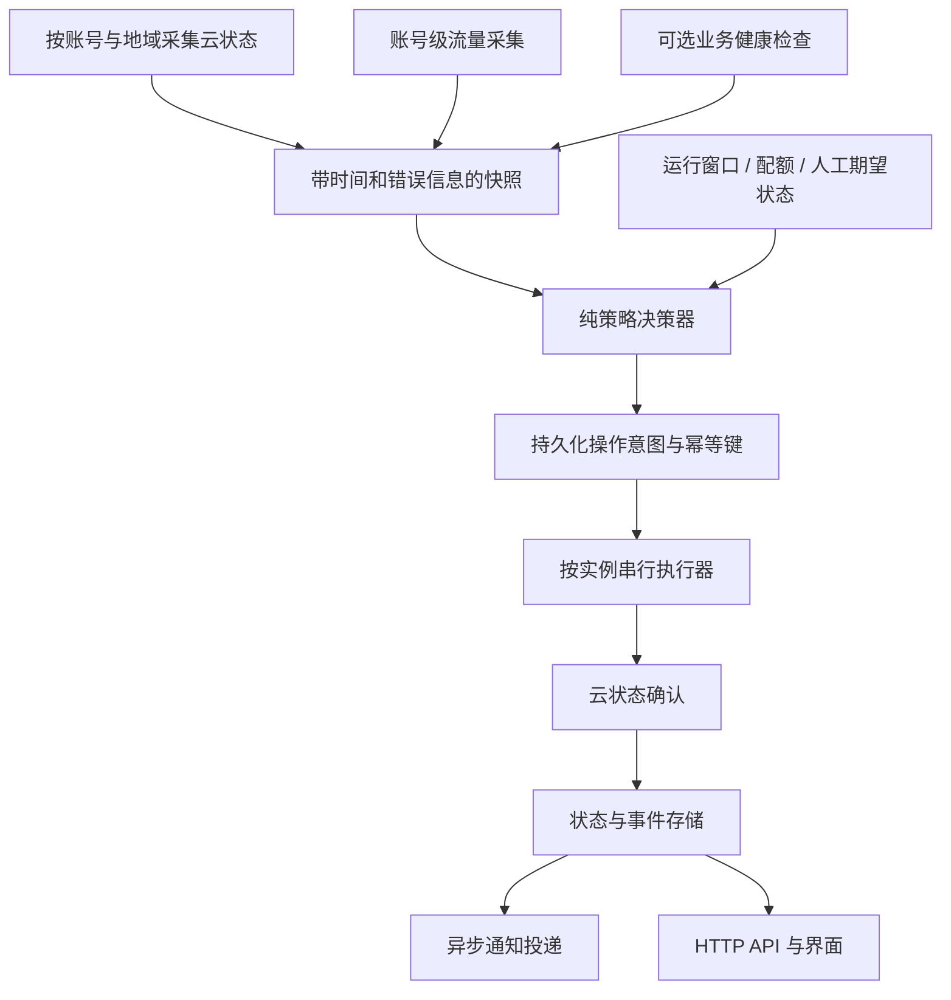

# CDT-Management 全面评估与重构建议

审查基线：上游 `3ccf6a7547e2ddb1d68756dd5e3c92fd253093e4`，v1.3.11。Fork：`zc12120/cdt-management`。本分支包含评估、脱敏验证结果和离线复现脚本，**尚未修复下列问题，也不是可以直接上线的重构版本**。

结论：值得继续维护，建议保留 Python + FastAPI + React + SQLite 的单容器形态，分阶段修复正确性与可靠性问题。现有测试、通知脱敏、AES-GCM、OpenRC 无关的云 API 控制方式，以及已有的换班边界处理都有复用价值。直接换语言或引入 Redis、微服务会增加单机保活的维护成本。

对于“外部管理机管理一台小内存 Alpine 抢占式 ECS”的用途，优先级最高的是：初始化和控制动作的并发安全、CDT 查询失败时的明确策略、云端运行与代理可用状态分离，以及可重复构建和测试。账号流量模型应在扩展到同账号多实例前改正。

## 范围与证据

检查了云 SDK 封装、保活/换班状态流转、事件确认、数据库及迁移、初始化/登录/会话、DNS、通知、前端数据刷新、Docker/安装脚本、CI 和依赖。没有对第三方运行实例进行渗透测试，没有执行真实启停或发送通知，没有把真实凭据放入仓库。

| 验证 | 结果 | 边界 |
| --- | --- | --- |
| Python 3.13.18，23 个 `test_*.py` 分进程运行 | 349 项：345 通过、4 个错误 | 4 个错误来自入口脚本测试的 mock，见 F9 |
| 隔离 dry-run 服务 + `scripts/smoke_test.py` | 141 项通过 | 合成账号与实例，不代表真实抢占恢复 |
| TypeScript + Vite 生产构建 | 通过 | 没有补浏览器 E2E 或无障碍测试 |
| `npm audit` | 0 个已知漏洞 | 本次锁文件和查询时点 |
| `pip-audit -r requirements.txt` | 26 个解析依赖，0 个已知漏洞 | Python 依赖未锁定，下次解析可能不同 |
| 离线故障与并发复现 | 结果见 [reproductions.json](review-20261110/reproductions.json) | 模拟响应不等于实网错误复现 |
| ECS 普通停机参数 DryRun | `Stop`、`KeepCharging` 都返回 `DRYRUN.SUCCESS` | 没有实际停机，不能据此证明两者生产行为等价 |

Python 3.10.12 的交叉检查也出现同样 4 个入口测试错误。HTTP 冒烟是在独立回环服务启动并就绪后执行，日志中的合成 session 没有加入仓库。测试后该临时服务已停止。

本地 Python 3.13 进程在 141 项冒烟后 RSS/HWM 为 89,860 KiB，约 87.8 MiB；静态前端 JS 275.41 kB（gzip 83.66 kB），CSS 54.79 kB。这是开发主机上的功能测试样本，不是容器完整内存、镜像磁盘或高负载上限。管理面板放外部常驻机器即可，目标小盘 ECS 不需要装面板或 Docker。

## 已复现或由源码确认的问题

优先级 P1 表示建议在无人值守使用前处理；P2 表示下一阶段处理或通过明确部署约束控制。并非所有问题都会影响“一账号一实例”的默认配置。

### F1 · P1：首次初始化存在竞争，可能留下两份有效管理员会话

位置：[api.py:666](../app/api.py#L666)、[repo.py:63](../app/repo.py#L63)、[api.py:285](../app/api.py#L285)。

`setup()` 的 initialized 检查在写事务之外。两个请求同时读到未初始化后都可以保存管理员信息，各自签发 epoch=0 的会话；后写的账号覆盖先写的账号，但 `_current_user()` 不比较票据用户名与当前管理员用户名，两份会话仍可用。

离线 ASGI 并发复现：两次 setup 均 HTTP 200；两份 Cookie 随后访问 `/auth/me` 均成功。触发前提是首次初始化窗口存在竞争；不能将其描述为已经初始化的站点可直接绕过登录。

建议：在同一 `BEGIN IMMEDIATE` 事务里完成“检查未初始化 → 写管理员 → 标记初始化”，失败者返回 409；登录身份变化应有清晰的会话 epoch 失效规则。首次部署默认回环监听或使用一次性引导令牌，再开放反代。

### F2 · P1：CDT 故障会阻止 ECS 状态刷新和保活动作

位置：[shift.py:3580](../app/shift.py#L3580)、[shift.py:711](../app/shift.py#L711)。

`_refresh()` 先查询流量，再查询 ECS。CDT 超时、限流或缺权限会直接异常退出；保活捕获异常后跳过该实例。本次注入 CDT 超时后，ECS 状态查询次数和启动次数均为 0，即使 ECS 接口本身可用也不查询。

这是明确的可用性/费用策略缺口，不能简单改为“失败就当流量为 0 并启动”。建议将状态、流量、账单做成独立快照，分别记录 `observed_at`、`error`、`freshness`。支持明确的费用优先策略与用户选择的可用性优先策略；已知超限不得因流量查询失败而解除，陈旧数据不得伪装为实时数据。

### F3 · P1（同账号多实例）：账号流量被复制到每台实例并重复求和

位置：[aliyun.py:418](../app/aliyun.py#L418)、[db.py:23](../app/db.py#L23)、[DashboardView.tsx:67](../web/src/components/DashboardView.tsx#L67)。

`ListCdtInternetTraffic` 未传实例 ID，累加的是账号返回的 TrafficDetails；随后写入每条 server 的 `traffic_used`，前端再逐 server 求和。两个同账号实例，账号共用 100 GiB 时，两个卡片都得到 100 GiB，总览显示 200 GiB。同账号的多把 RAM AK 也不能被视为独立免费额度。

建议引入 Account 与 Credential 实体：账号归属和凭据不是同一概念。账号/CDT 产品地域维度只采一次，免费额度和告警按正确范围聚合；Instance 负责运行状态。界面明确“账号已用/实例流量未知”，避免把账号总量标成实例计量。对 GB/GiB、计费周期及境内外额度分别定义，不能以实时硬上限宣传有延迟的云 API 数据。

### F4 · P2：手动启停的防重复检查不是原子的

位置：[shift.py:2759](../app/shift.py#L2759)、[repo.py:1154](../app/repo.py#L1154)。

`manual_action()` 没有使用 Engine 的锁。“是否存在 pending → 调云 API → 创建事件”之间可以并发穿透。复现中两次同时停止下发了两次云命令。顺序调用的既有测试能通过，不能证明并发幂等。云 API 可能自行拒绝重复请求，但应用仍可能产生冲突事件、重复请求或相反操作竞争。

建议按实例序列化控制，先以唯一约束持久记录 operation intent，再执行云命令；同目标请求返回同一个 operation ID。处理崩溃恢复与最终状态确认，不能宣称只靠进程内锁实现云命令 exactly-once。

### F5 · P2：信任所有私网来源的 X-Forwarded-For 可绕过登录限速

位置：[api.py:1337](../app/api.py#L1337)。

当直连 peer 为私网地址时，代码直接采用 XFF 第一项。若反代追加而不覆盖用户 XFF，或网络映射使 peer 呈现私网地址，客户端可以更换 XFF 来更换限速桶。复现中原地址达到 8 次失败后被限速，改变 XFF 即不再被限速。

这依赖代理拓扑，不意味着所有公网直连都受影响。建议只信任明确配置的代理地址，约定代理覆盖来源头；与 Uvicorn 的 proxy headers 处理保持一致。增加账号维度节流，防止只按可变来源标识限速。

### F6 · P2：HTTP health 不能代表保活控制器就绪

位置：[api.py:653](../app/api.py#L653)、[scheduler.py:43](../app/scheduler.py#L43)、[Dockerfile:54](../Dockerfile#L54)。

`/api/health` 固定返回 ok。没有启动 scheduler 的 ASGI 应用也返回 HTTP 200；线程阻塞或控制器长期未成功对账时，容器 healthcheck 仍可能正常。这对保活管理程序尤其容易误导。

保留 liveness，另加 readiness：后台线程存活、上次轮次时间、轮次耗时、DB 可写、SDK 可用、关键快照新鲜度。ECS 的 Running 和代理业务可用性应分开显示。Reality 探测可在外部管理机执行，不要求目标 ECS 安装常驻 agent。失败应先区分线路、证书、服务与云状态，避免误重启循环。

### F7 · P2：账单没有处理分页，且 ECS 账单不等于整套节点费用

位置：[aliyun.py:277](../app/aliyun.py#L277)。

`DescribeInstanceBill` 仅取一次 MaxResults=300，忽略 NextToken。模拟第一页带下一页 token 时只调用一次接口并直接返回首屏金额。是否在特定单实例账期实际触发分页，取决于账单数量，不能断言每个账号都少算。

另外，仅以 ECS InstanceID 筛选，不会自动汇总独立 EIP、共享带宽、CDT、快照等资源。建议实现分页与完整性标志，区分 ECS 自身消费和关联资源费用；明确账单延迟，不将它作为实时防超额依据。

### F8 · P2：并发追加事件进度可能丢失步骤

位置：[repo.py:1195](../app/repo.py#L1195)。

进度保存在 JSON 字符串中，执行“读整个数组 → append → 覆盖 UPDATE”，无事务或版本条件。调度线程、确认线程和 API 都可能追加。确定性并发复现：提交两条不同步骤，只保存一条。

建议将步骤存为单独 append-only 表，保留 event_id、sequence、dedupe_key；或先用短事务/CAS 解决丢更新。清理策略仍应有上限，不要改成无限累积日志。

### F9 · P2：测试和发布门禁不足，fork 默认发布目标仍指向上游

位置：[test_entrypoint.py:177](../scripts/test_entrypoint.py#L177)、[build.yml](../.github/workflows/build.yml)、[install.sh:19](../install.sh#L19)。

- 4 个入口测试错误来自 mock 整个 `os.lstat`，使 `Path.resolve()` 读到没有正确 st_mode 的 Mock。Python 3.10 和 3.13 都复现；这是测试替身的问题，不是已经证明容器入口在真实系统必定失败。
- 现有 workflow 构建镜像但不运行这些测试，没有 pull_request 测试门禁，且 scripts 路径被忽略。
- `.github/workflows/build.yml` 的镜像命名空间、compose、安装脚本及其回退镜像仍指向 BeacherZ；fork 的更新检测也默认查询上游。仅修改 fork 源码再运行原安装器，并不能保证部署的是修改后的版本。
- Python 依赖是宽范围约束，构建的上游基础镜像未按 digest 固定。相同提交重新构建不保证相同依赖结果；本次零已知漏洞结果不能替代后续更新检查。

建议先修测试替身，建立 Python 3.13 后端测试 + 本地 dry-run HTTP 冒烟 + TS/build 的 PR CI，再改发布命名空间及测试通过后发布流程。保留原许可证与 NOTICE。依赖更新采用可审查的锁文件与定期升级，不把永久锁旧版本当安全策略。

## 需要区分的契约风险与改进项

### 普通停机参数：建议规范化，但不宣称已证实实网停机失败

应用以 `Stop` 作为普通停机内部值并原样传给 StopInstances。当前官方文档列出 `StopCharging` / `KeepCharging`。本次实际 DryRun（AllTogether）对 `Stop` 和 `KeepCharging` 都返回成功；因此证据仅支持“与公开契约不一致”，不足以证明真实停止必定失败。

建议保留旧配置兼容，在云适配层将内部普通停机语义规范为文档值 KeepCharging。必须继续从 DescribeInstances 确认真实停机模式；不要只把请求参数当成已生效计费模式。没有为验证此项实际关机。

### 批量启停响应未检查逐实例业务码

`start_instance()` / `stop_instance()` 丢弃返回 JSON。构造 HTTP 成功但 InstanceResponse.Code 为失败的响应时，不抛异常；stop 还返回请求模式。当前默认 AllTogether 的真实失败可能先在 RPC 层抛出异常，**本次未实网复现业务失败被吞**，所以将其视为适配器契约缺口。

建议对每个目标实例验证请求结果，区分“已接受”“业务失败”“状态已符合”；保留现有后续状态确认，不能把操作受理当成完成。

### 其他设计改进

- `/api/health` 只能证明 HTTP 活着；云接口监测、代理实际健康和通知发送结果应是不同字段。
- 登录 Cookie 未启用 Secure；应提供 HTTPS 部署选项，并与可信反代设置配套。数据库中 Webhook URL、含认证信息的代理 URL 等敏感字段也需统一分类，而非只按字段名包含 password/token 处理。
- 已注销会话黑名单查询出错时当前按“未注销”放行；建议明确安全策略，失败时返回可恢复的服务不可用，尤其是云控制写请求。
- 通知发送和 DNS/账单网络请求仍有同步等待，异常捕获不等于没有阻塞。可用 SQLite outbox 把通知投递从控制动作中移出，避免引入额外基础设施。
- 单容器单进程约束合理，但需要启动时明确检查。未来如要多副本，需要租约/主节点协议；不能简单增加 Uvicorn workers。
- 日志/采样清理虽有上限，但表内记录过期不保证 SQLite 文件立即缩小。为备份提供 SQLite backup API + master.key 的一致性方案，并做隔离恢复演练；在线直接复制 db 文件不能保证带上 WAL 中的数据。
- 安装器升级会先删除旧容器再启动新容器，没有自动恢复已知正常版本。后续应先保存镜像 digest、运行参数和数据备份，完成健康验证后再认定升级成功。

## 建议的重构边界

最大的耦合点是 `shift.py`（3,606 行）：`reconcile_group()` 单函数 777 行，调度策略、云请求、持久状态、通知和进度文案混在一起。`api.py`（1,381 行）与 `repo.py`（1,394 行）也同时承担过多职责。拆分目标是使行为可测试，不是机械地把一个函数分到多个文件。

推荐目录：`cloud/` 处理 SDK 与响应规范；`domain/` 定义 Account、Instance、Observation、Operation 及枚举；`policy/` 分保活、排班、额度；`services/` 执行控制与确认；`storage/` 管事务和迁移；`http/` 放路由与请求模型。现有 API 可作为兼容层，避免前后端同时大改。

请求模型使用明确类型验证；纯策略函数只返回 Start/Stop/Wait/Alert 等决定，不直接访问网络、数据库和系统时钟。将 clock、cloud、notifier 作为可替换依赖，逐步减少全局模块 monkeypatch。

账号采集按账号去重；DescribeInstances 可按账号与地域批量查询，再以有界并发处理不同账号。保持每个实例的控制串行，不应为了吞吐并发发出相反命令。单实例部署不需要此优化带来的复杂队列。

## 分阶段实施与验收

| 阶段 | 工作 | 验收 |
| --- | --- | --- |
| 1：修正确性与建立门禁 | 初始化原子化、手动控制幂等、事件追加原子化、修入口测试、PR CI、fork 镜像目标 | 当前 349 项全部通过；并发 setup 仅一人成功；重复操作只提交一次；两条进度都保存 |
| 2：保活可靠性 | 独立状态/流量快照、显式失效策略、云响应校验、readiness、可选 Reality 探测 | 注入 CDT 超时/ECS 超时/库存不足/长 Starting/服务卡住，各自状态和行为可解释；已知超限不被失败读数解除 |
| 3：账号模型迁移 | Account/Credential/Instance 分离、流量去重、账单分页、相关资源费用口径 | 同账号两个实例只计一次；AK 轮换不新建额度；迁移前后节点、设置、密钥可恢复 |
| 4：拆分引擎和维护体验 | 提取纯 planner、通知 outbox、前端 hooks 与类型模型、升级回滚 | 旧行为的回归测试保持，控制器关闭/重启可恢复，界面明确 stale/unknown/pending |

每阶段独立分支、独立回滚点。数据库迁移使用版本号、应用一致备份和临时目录恢复验证，不能在大规模重命名同时改状态语义。不要一次性重写 3,600 行引擎后才补测试。

## 建议的部署形态

管理面板固定已测试版本，放在外部常驻服务器；端口先绑定回环，再使用 HTTPS 反代或隧道。使用专用 RAM 用户，只允许目标实例的 DescribeInstances/StartInstances/StopInstances 和账号 CDT 只读；BSS、Cloudflare 和通知按启用功能单独授权。

单实例全天保活保持简单：不开联合换班，固定 EIP 不需要 DDNS；Alpine 继续通过 OpenRC 管理代理，面板不依赖目标系统的 systemd。增加服务健康检查时优先在管理机执行，并区分“网络不可达”和“进程故障”。

本次没有部署 fork、启用自动启停、创建新通知渠道或更改正在运行的代理。建议先完成阶段 1 与阶段 2 的核心项，再用于长期无人值守。

## 复现与参考

隔离 venv 安装 requirements、httpx 后运行 `python scripts/review_reproduce_20261110.py`。它是审查诊断脚本，打印当前实现的行为，**不是“发现问题也算测试通过”的验收套件**。修复时应将相应观察改写为预期正确行为的回归测试。

- [测试摘要](review-20261110/validation.json)
- [Python 3.13 分文件结果](review-20261110/unit-tests.json)
- [离线复现结果](review-20261110/reproductions.json)
- [官方 StopInstances 参数与 DryRun](https://www.alibabacloud.com/help/en/ecs/developer-reference/api-ecs-2014-05-26-stopinstances)
- [官方 StartInstances 响应结构](https://www.alibabacloud.com/help/en/ecs/developer-reference/api-ecs-2014-05-26-startinstances)
- [官方 DescribeInstanceBill 分页与延迟](https://www.alibabacloud.com/help/en/user-center/developer-reference/api-bssopenapi-2017-12-14-describeinstancebill)
- [上游关于账单与流量延迟的讨论](https://github.com/BeacherZ/cdt-management/issues/4)

未覆盖：真实库存争抢、故障云 API 的长时间恢复、浏览器全流程、完整容器的 amd64/arm64 构建运行、生产备份恢复演练及多年数据迁移。零已知依赖漏洞、模拟测试通过和本地资源数据都不构成这些场景已验证的证据。
